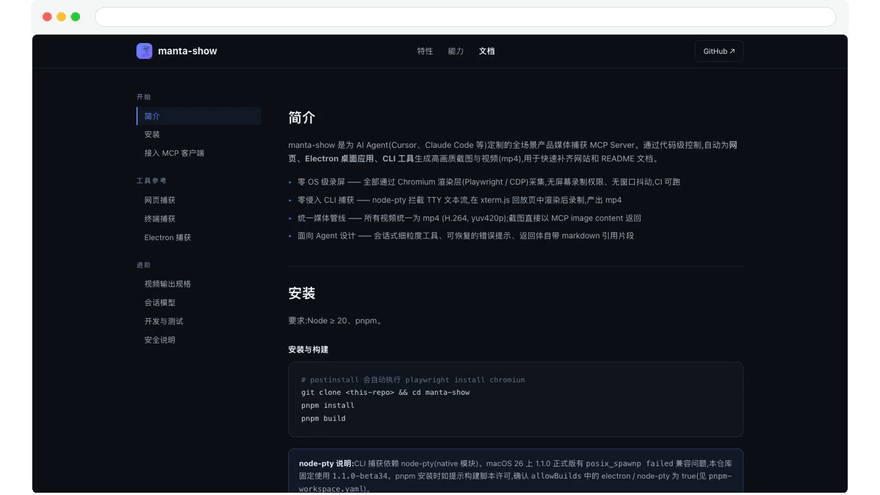
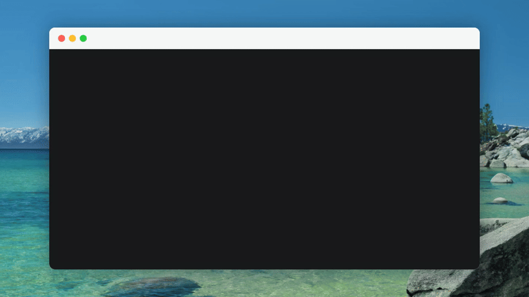

# manta-show

[English](README.md) | 简体中文

为 AI Agent（Cursor、Claude Code 等）定制的产品媒体捕获 MCP Server：通过代码级控制，为**网页、Electron 桌面应用、CLI 工具**生成高画质截图与视频（mp4），快速补齐网站和 README 文档。

- **零 OS 级录屏** — Chromium 渲染层采集（Playwright / CDP），无屏幕录制权限、无窗口抖动，CI 可跑
- **零侵入 CLI 捕获** — node-pty 拦截 TTY 文本流，在 xterm.js 回放页中渲染后录制
- **统一媒体管线** — 视频统一 `mp4 (H.264, yuv420p)`；截图直接以 MCP image content 返回
- **面向 Agent 设计** — 会话式细粒度工具、可恢复的错误提示、返回体自带 markdown 引用片段

## 效果预览

以下素材由 manta-show 自身生成（网页线用批量动作录制一次成片，终端线用交互工具实录 `npm install`），随时可用 `pnpm demos` 重新生成：





## 与同类工具的对比

manta-show 与它们不是替代关系，而是分工不同：Playwright MCP 强在交互自动化，vhs 强在脚本化 CLI 录制，OS 录屏工具强在人工自由发挥——manta-show 专注的是「Agent 驱动的媒体产出管线」这一环。

| | manta-show | Playwright MCP | vhs | OS 录屏（CleanShot 等） |
|---|---|---|---|---|
| 定位 | Agent 自动产出文档媒体 | Agent 驱动网页交互 / 测试 | 脚本化 CLI demo 录制 | 人工屏幕录制 |
| 网页截图（组件级 / 整页） | ✓ | ✓ | — | ✓（手动） |
| 视频输出 | ✓ 统一 1080p mp4 | ✗ | ✓（需写 .tape 脚本） | ✓（需后期剪辑） |
| 窗框装饰 / 合成鼠标 | ✓ 开箱即用 | ✗ | 部分（主题） | 靠后期 |
| CLI 工具录制 | ✓（pty + xterm 回放） | ✗ | ✓ | ✓（手动） |
| Electron 应用 | ✓ | ✗ | ✗ | ✓（手动） |
| 系统权限 / CI | 无需录屏权限，CI 可跑 | 无 | 无 | 需录屏权限，不可 CI |
| 驱动方式 | AI Agent | AI Agent | 人工写脚本 | 人工操作 |

## 快速开始

在 MCP 客户端中加入配置，Claude Code（项目级 `.mcp.json` 或 `~/.claude.json`）：

```json
{
  "mcpServers": {
    "manta-show": {
      "command": "npx",
      "args": ["-y", "@manta-show/mcp"]
    }
  }
}
```

Cursor（`~/.cursor/mcp.json`）使用同样结构；全局安装过（`npm install -g @manta-show/mcp`）可直接用 `manta-show` 二进制；也可运行 `manta-show init`，自动检测已安装的 AI Agent 并写入配置，随后完成环境准备：检测 Chromium / ffmpeg，缺失项一次性确认后**带下载进度**自动安装（走 npmmirror 镜像加速），装完即开箱可用。

首次使用后如需重新体检或修复，环境依赖缺失项同样带进度自动补齐：

```bash
manta-show doctor
```

媒体产物统一保存在固定目录 **`~/.manta-show/media`**（截图 / 视频按 `web-` / `terminal-` / `electron-` 前缀区分来源），`manta-show recordings` / `manta-show clean` 对该目录做列出与清理。

环境变量（均可不配）：

| 变量 | 默认 | 说明 |
|---|---|---|
| `MANTA_SHOW_FFMPEG` | 自动定位 | 指定 ffmpeg 可执行文件路径 |
| `MANTA_SHOW_LANG` | `en` | 界面语言（工具描述、返回信息与 CLI 输出）：`en`（默认）、`zh-CN`；未知值回退 `en` |
| `PLAYWRIGHT_DOWNLOAD_HOST` | npmmirror 镜像 | init/doctor 下载 Chromium 时生效，已有配置则尊重 |

不想在 shell 里 export 时，可用 `manta-show set --env MANTA_SHOW_LANG=zh-CN` 持久化（`--env` 可重复）；值保存在 `~/.manta-show/config.json`，启动时自动应用。真实环境变量优先于已保存值。

## 工具清单

三类录制（网页 / 命令行 / Electron）默认统一输出 **1920×1080（16:9）**，等比缩放后居中补边（浏览器白底、终端深色底），`*_record_stop` 传 `fit: 'native'` 保持录制原始尺寸。

- **装饰**：录制类工具支持 `decorate` 叠加 macOS 视觉装饰（浏览器窗框、终端窗框、桌面壁纸），默认开启，`'none'` 为原始画面；录制默认注入**合成鼠标指针**（跟随真实移动，点击有波纹反馈），`cursor: false` 可关闭
- **选择器**：交互工具的 `selector` 支持 CSS 与 Playwright 选择器语法（`text=登录`、`role=button[name="提交"]`、`xpath=…`），通常配合 snapshot 的可访问性树直接使用
- **会话**：所有交互工具接受可选 `sessionId`，不填时操作该类型最近活跃的会话（空闲 10 分钟自动回收），Agent 通常无需手动传

### 网页（Playwright Chromium，无头，默认 2x 高清）

| 工具 | 说明 |
|---|---|
| `browser_open` | 打开网页，返回 sessionId |
| `browser_navigate` | 会话内跳转 |
| `browser_snapshot` | 可访问性树快照，用于确定选择器 |
| `browser_click` / `browser_hover` | 按选择器点击 / 悬停（支持 CSS / `text=` / `role=` 等） |
| `browser_type` | 输入文本（可选回车提交） |
| `browser_press_key` / `browser_scroll` | 按键 / 滚动 |
| `browser_evaluate` | 在页面执行 JS 表达式 |
| `browser_screenshot` | 截图（`selector` 元素级裁剪，`fullPage` 整页），返回图片 + 路径 |
| `browser_record_start` / `browser_record_stop` | 录制期间继续交互，stop 产出 mp4；start 传 `steps` 可按顺序自动执行编排好的动作并自动出片 |
| `browser_close` | 关闭会话 |

典型流程：`browser_open` → `browser_snapshot` 找选择器 → `browser_click`/`browser_type` 交互 → `browser_record_start` → 演示动作 → `browser_record_stop` 拿 mp4 → 把返回的 markdown 引用片段插入 README。

编排好的演示可走批量模式一次成片（`steps` 支持点击 / 悬停 / 输入 / 按键 / 滚动 / 执行 JS / 等待，全部完成后自动停止并直接返回 mp4；中途某步失败也会停录并导出已完成部分）：

```json
{
  "decorate": "browser",
  "steps": [
    { "type": "click", "selector": "text=登录" },
    { "type": "type", "selector": "#q", "text": "manta-show", "submit": true },
    { "type": "wait", "ms": 800 },
    { "type": "scroll", "dy": 600 }
  ]
}
```

### 命令行工具（node-pty + xterm.js 回放页）

| 工具 | 说明 |
|---|---|
| `terminal_open` | 启动命令并自动开始录制；`cwd` 指定工作目录，`env` 注入环境变量，`isolation: 'container'` 在一次性 Docker 容器中运行（见下） |
| `terminal_read` | 读最近 N 行渲染后纯文本（去 ANSI），Agent 判断状态用 |
| `terminal_send` / `terminal_send_key` | 输入文本 / 具名按键（enter、ctrl+c、上下左右……） |
| `terminal_wait` | 阻塞等待输出中出现指定文本（子串匹配）或超时，附最近输出——比反复 `terminal_read` 轮询省轮次 |
| `terminal_record_stop` | 导出 mp4 |
| `terminal_stop` / `terminal_close` | 结束进程 / 释放会话 |

两种用法，语义不同：

- **`open` 直接运行命令**（如 `command: "npm"`）——命令作为参数启动，只录输出，命令本身**不会出现在画面中**。适合捕获一次性 CLI、CI 场景
- **演示"命令被敲入并执行"**——先 `open` 交互 shell（`command: "bash"`, `args: ["-i"]`），再用 `terminal_send` 发送命令。输入内容由 TTY 回显进画面，效果与真人操作一致

按命令行为选隔离方式：**自包含命令**（安装、构建、demo CLI）和**操作某个项目目录的命令**（scaffold、build、lint 等，`cwd` 指向样例项目即可——容器内对它的读写都是真实的，产物落回宿主）用 `isolation: 'container'`，既真实又可复现，且不会把真实项目/配置录进画面；**读写用户真实环境的命令**（如 `manta-show init` 写 `~/.claude.json`、检测已装软件）必须在宿主运行——容器里没有这些环境。这类命令重复录制时，可用 `env: { HOME: "/tmp/demo-home" }` 指向预先构造好标记文件的一次性目录（如 `touch /tmp/demo-home/.claude.json`），完整演示"检测 → 写入"流程且不碰真实配置。

> **重复演示与状态隔离**：CLI 的所有状态都落在文件系统上，重复录制同一条命令会因上次残留（已安装、文件已存在、缓存命中）而走样。`terminal_open` 传 `isolation: 'container'` 即可让命令在一次性 Docker 容器中运行——与 CI 的临时环境同一机制，命令及其全部状态变化与宿主完全隔离，容器退出即销毁：
>
> ```json
> {
>   "command": "npm",
>   "args": ["install", "-g", "@some/cool-pkg"],
>   "isolation": "container",
>   "image": "node:22"
> }
> ```
>
> 每次录制都是真实的首次安装，宿主零污染。`image` 可锁定版本保证可复现；传 `cwd` 时该目录挂载到容器 `/workspace`（CLI 生成的文件可从宿主查看），不传则容器文件系统自包含。需要本机有 Docker 或 Podman（macOS 推荐 OrbStack / colima；`manta-show doctor` 会检查并给出安装指引）。
>
> **容器环境按场景定制**（`isolation: 'container'` 时）：运行时用 `image`（`python:3.12`、`golang:1.22`……）；模拟项目文件在宿主准备夹具目录后传 `cwd`；注入模拟的全局配置等用 `volumes`（docker 语法，如 `["/tmp/demo-gitconfig:/root/.gitconfig"]`）；容器内预装依赖、造文件用交互 shell（`command: "bash", args: ["-i"]` + `terminal_send`），这些准备动作本身也是可录制的演示内容。

### Electron 应用（Playwright `_electron`）

| 工具 | 说明 |
|---|---|
| `electron_launch` | 启动应用并捕获主窗口 |
| `electron_snapshot` | 界面可访问性快照 |
| `electron_click` / `electron_type` / `electron_press_key` | 界面交互 |
| `electron_screenshot` | 窗口 / 元素截图 |
| `electron_record_start` / `electron_record_stop` | 录制 / 导出 mp4；start 传 `steps` 可批量执行动作并自动出片 |
| `electron_close` | 关闭应用 |

## 安全说明

`browser_evaluate` 会在页面上下文执行任意 JS、`terminal_open` 会在本机启动任意进程——这是本工具的设计用途（本机开发 / 文档场景），请在信任的项目中使用。安全漏洞请通过 [SECURITY.md](SECURITY.md) 描述的渠道私密上报，不要开公开 issue。

## 参与贡献

欢迎 issue 与 PR，见 [CONTRIBUTING.md](CONTRIBUTING.md)；变更记录见 [CHANGELOG.md](CHANGELOG.md)。

## 开发

要求：Node ≥ 20、pnpm。

```bash
git clone <this-repo> && cd manta-show
pnpm install
npx playwright install chromium
pnpm build
```

```bash
pnpm dev        # tsc --watch
pnpm test       # 快速单测（node:test，不依赖浏览器）
pnpm test:e2e   # 构建 + e2e（InMemoryTransport 直连，覆盖三条线）
pnpm demos      # 重新生成 README / 网站用的 demo 素材（website/media/）
pnpm start      # stdio 方式启动 server
```

项目结构（pnpm monorepo）：

```
manta-show/
├── packages/mcp/        # @manta-show/mcp —— MCP Server 本体（bin: manta-show）
│   ├── src/  test/  dist/  assets/
├── packages/node-pty/   # node-pty fork 源码 + 平台预编译包打包脚本
├── scripts/             # ffmpeg 平台包打包脚本（pack-ffmpeg.js）
├── website/             # 项目介绍网站（纯静态，index.html + docs.html）
└── pnpm-workspace.yaml  # workspace 与构建脚本许可配置
```

从源码接入 MCP 客户端时，`command` 用 `node`、`args` 指向 `packages/mcp/dist/index.js`。

### 原生依赖与发布（node-pty / ffmpeg 两条管线）

npm 12 起默认屏蔽依赖的 install/postinstall 脚本，原生二进制不能依赖「装包时编译或下载」。仓库里两条原生依赖管线用同一套方案解决：**按平台拆成 optionalDependency 子包，二进制直接打进 tarball，零生命周期脚本**，缺包时各自优雅回退。两者都由打 tag 触发的同一个 [release workflow](.github/workflows/release.yml) 发布（各平台包的首个版本受 npm OIDC 限制，需手动从 CI artifacts 引导发布一次，之后全自动）。

| | `@manta-show/node-pty`（编译管线） | `@manta-show/ffmpeg-<platform>-<arch>`（再分发管线） |
|---|---|---|
| 源码 | fork 源码在仓库 `packages/node-pty/`（为 macOS 26 `posix_spawnp` 兼容固定在 `1.1.0-beta34`） | **无源码、不编译** |
| 二进制来源 | CI 内 `node-gyp rebuild` 自行编译（5 组平台×架构矩阵） | 下载 [ffmpeg-static](https://github.com/eugeneware/ffmpeg-static) 的预编译静态构建，gunzip 后直接再分发 |
| 打包脚本 | `packages/node-pty/scripts/pack-platform.js` | `scripts/pack-ffmpeg.js`（拷贝二进制 + 写 GPL 许可声明 + `npm pack`） |
| 版本号 | 跟随 fork：`1.1.0-beta34.x`（fork 点 + 补丁序号） | 跟随上游 ffmpeg：`6.1.1`（与 manta-show 版本无关） |
| npm tag | `beta` | `latest`（上游版本本身稳定） |
| 缺包回退 | install 脚本回退本地 `node-gyp rebuild` | 定位链回退 PATH / Homebrew / `~/.manta-show/bin`（见下方故障排查） |

升级操作：

- **node-pty**：改 `packages/node-pty/` 的 fork 源码 → 递增 `package.json` 里的 beta 序号（`1.1.0-beta34.x`，可借助 `scripts/increment-version.js`）→ 同步更新 `packages/mcp/package.json` 的依赖 pin 和 `pnpm-workspace.yaml` 的 `minimumReleaseAgeExclude` → 打 tag 触发发布。
- **ffmpeg**：改 workflow 里的 `FFMPEG_TAG` 常量（对应 ffmpeg-static 的 release tag，包版本号 = tag 去掉 `b` 前缀）→ 同步更新 `packages/mcp/package.json` 的 optionalDependencies pin 和 `pnpm-workspace.yaml` 的 `minimumReleaseAgeExclude` → 打 tag 触发发布。

### 故障排查

- **ffmpeg 定位失败**：按 `MANTA_SHOW_FFMPEG` → PATH → Homebrew 默认位置（`/opt/homebrew/bin`、`/usr/local/bin`）→ `~/.manta-show/bin`（init/doctor 下载）→ 内置预编译包 `@manta-show/ffmpeg-<platform>-<arch>` 顺序自动定位。定位失败不缓存，装好后（如 `brew install ffmpeg`）下一次录制即生效，无需重启 MCP server。注意 playwright 自带的 ffmpeg 是裁剪版（无 libx264），不能用于本项目。
- **node-pty 启动失败（macOS 26）**：CLI 捕获依赖 node-pty（native 模块），macOS 26 上 1.1.0 正式版有 `posix_spawnp failed` 兼容问题，本仓库固定使用 `1.1.0-beta34`。
- **pnpm 构建脚本被拦截**：确认 `pnpm-workspace.yaml` 的 `allowBuilds` 中 electron / node-pty 为 true。
- **网络受限**：内置 ffmpeg 以无 install 脚本的平台包形式随 npm 分发（npmmirror 自动镜像），安装无需访问 GitHub；仅在平台包未覆盖的环境上，才需要跑一次 `manta-show doctor` 从 npmmirror 镜像下载 ffmpeg 到 `~/.manta-show/bin`。

## License

MIT，见 [LICENSE](LICENSE)。
